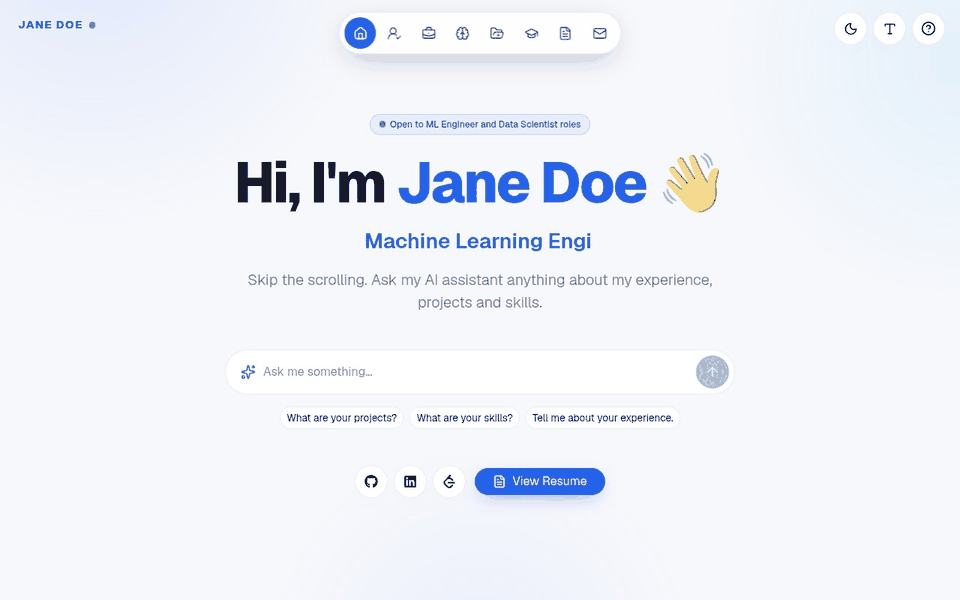
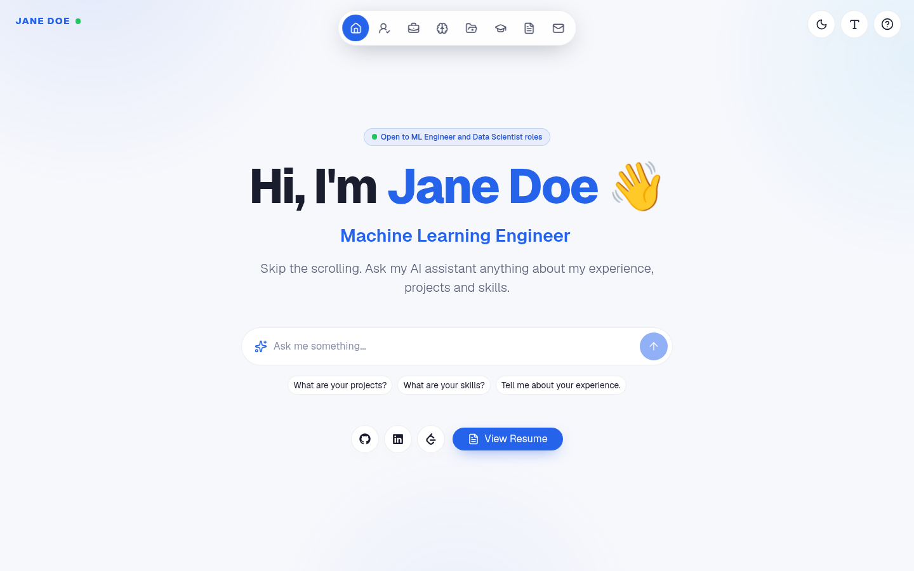
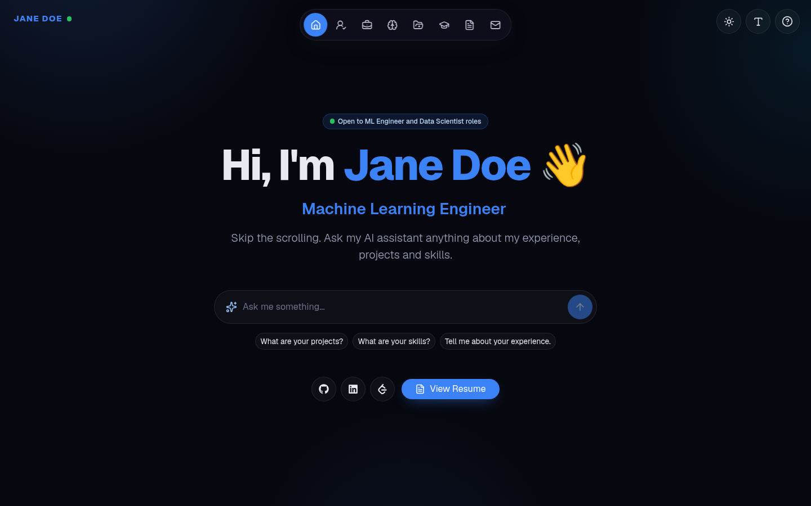
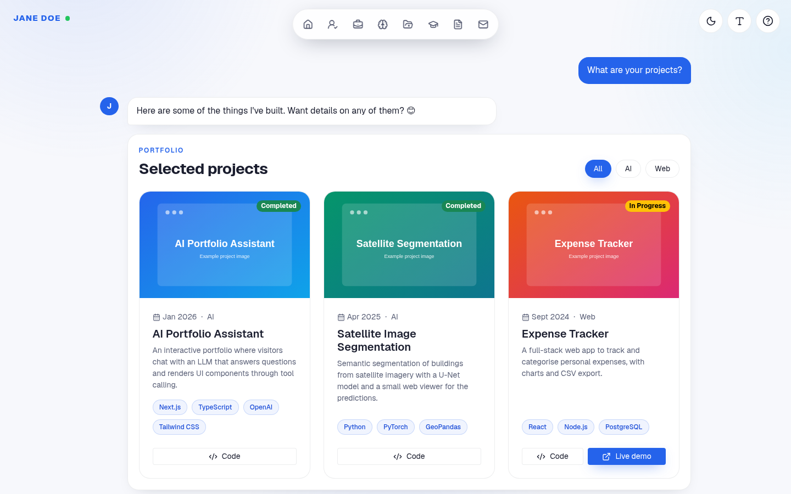
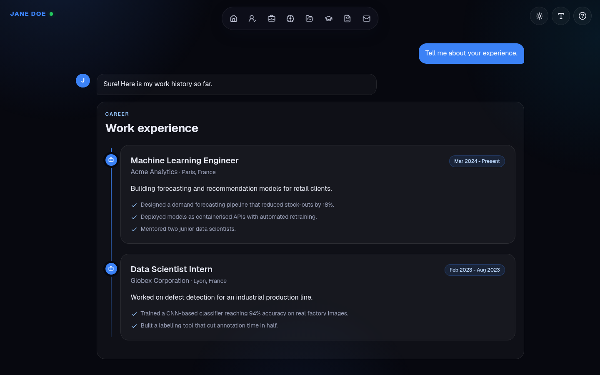
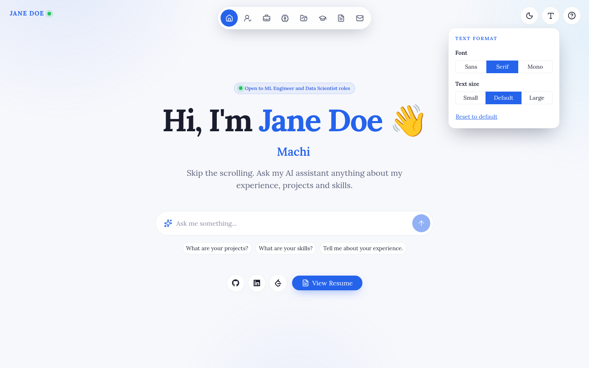
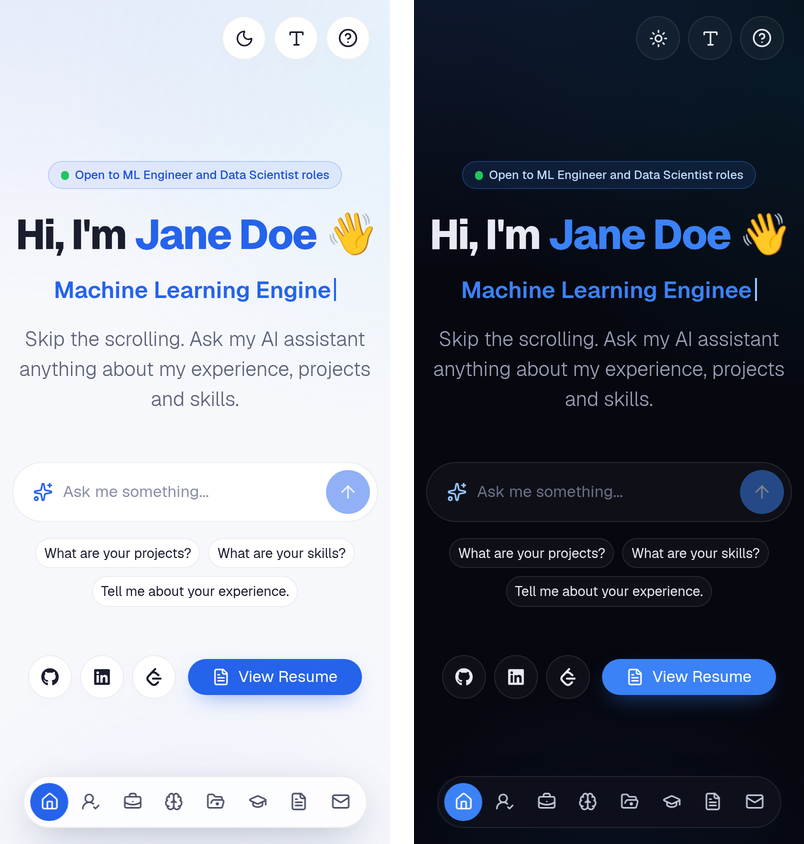
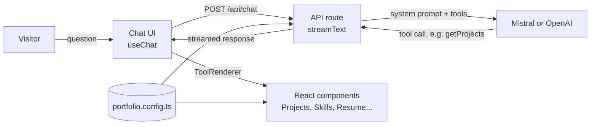

<div align="center">

# AI Portfolio

**A personal portfolio you can talk to.**

Visitors chat with an AI version of you. It answers questions about your projects, skills and experience,
and renders interactive sections (projects, timeline, resume, contact form) directly in the conversation.
All of your content lives in a single configuration file.

<br/>


[Demo](#demo) &nbsp;&middot;&nbsp;
[Features](#features) &nbsp;&middot;&nbsp;
[Screenshots](#screenshots) &nbsp;&middot;&nbsp;
[Quick start](#quick-start) &nbsp;&middot;&nbsp;
[Customize](#make-it-yours) &nbsp;&middot;&nbsp;
[How it works](#how-it-works) &nbsp;&middot;&nbsp;
[Deploy](#deploy)

</div>

---

## Demo

<p align="center">
  
</p>

<p align="center"><sub>All content shown is example data from <code>portfolio.config.ts</code>.</sub></p>

---

## Features

- **Conversational portfolio.** An LLM answers in the first person, using only the facts you provide.
- **Generative UI.** The model calls tools such as `getProjects` or `getSkills`, and the chat renders real React components instead of plain text.
- **One config file.** Name, bio, experience, education, projects, skills, socials, resume and chatbot tone all live in `portfolio.config.ts`.
- **Resume support.** Drop one or more PDFs in `public/resume/`. Visitors can view or download them.
- **Working contact form.** Powered by [Web3Forms](https://web3forms.com), with honeypot spam protection.
- **Streaming responses.** Answers stream token by token through the Vercel AI SDK.
- **Light and dark themes.** Built on Bootstrap 5 color modes. Visitors switch with one click and their choice is remembered.
- **Text format options.** Visitors can pick the font (sans, serif or mono) and the text size (small, default or large).
- **Modern, responsive UI.** Floating navigation dock, timeline views, typewriter hero title and smooth transitions with Framer Motion.
- **No secrets in code.** API keys are read from environment variables only.

---

## Screenshots

| Light theme | Dark theme |
|---|---|
|  |  |

**The chat answers with interactive sections**

| Projects | Work experience |
|---|---|
|  |  |

| Text format menu | Mobile |
|---|---|
|  |  |

---

## Quick start

**Requirements:** Node.js 18.18 or newer, and [pnpm](https://pnpm.io) (npm or yarn also work).

```bash
# 1. Clone the repository
git clone https://github.com/T81oub/My-portfolio.git
cd My-portfolio

# 2. Install dependencies
pnpm install

# 3. Create your environment file
cp .env.example .env.local

# 4. Start the dev server
pnpm dev
```

Open [http://localhost:3000](http://localhost:3000). The site starts with example data for a fictional "Jane Doe" until you replace it.

### Environment variables

| Variable | Required | Description |
|---|---|---|
| `MISTRAL_API_KEY` | One of the two | Mistral key (free tier available). Get one at [console.mistral.ai](https://console.mistral.ai/api-keys). |
| `MISTRAL_MODEL` | No | Mistral model to use. Defaults to `ministral-3b-latest`, the smallest model. `ministral-8b-latest` and `mistral-small-latest` give better answers. |
| `OPENAI_API_KEY` | One of the two | OpenAI key. Get one at [platform.openai.com](https://platform.openai.com/api-keys). |
| `OPENAI_MODEL` | No | OpenAI model to use. Defaults to `gpt-4o-mini`. |
| `NEXT_PUBLIC_WEB3FORMS_ACCESS_KEY` | No | Enables the contact form. Free at [web3forms.com](https://web3forms.com). |

**Which model is used?** If `MISTRAL_API_KEY` is set, the chatbot uses Mistral. Otherwise it falls back to OpenAI.
To switch back to OpenAI, just leave `MISTRAL_API_KEY` empty.

> `.env.local` is git-ignored. Never commit real keys.

---

## Make it yours

Everything personal is in **[`portfolio.config.ts`](portfolio.config.ts)**. You do not need to touch any component.

### 1. Edit your information

```ts
const portfolio: PortfolioConfig = {
  site: {
    title: "Jane Doe | Machine Learning Engineer",
    description: "...",
    brand: "JANE DOE",
  },
  profile: {
    name: "Jane Doe",
    shortName: "Jane",
    title: "Machine Learning Engineer",
    roles: ["Machine Learning Engineer", "Data Scientist"], // rotating hero titles
    location: "Paris, France",
    email: "jane.doe@example.com",
    avatar: "/images/avatar-placeholder.svg",
    openToWork: true,
    bio: ["Hello! I'm **Jane Doe**, ..."], // **bold** is supported
  },
  experience: [ /* ... */ ],
  education:  [ /* ... */ ],
  projects:   [ /* ... */ ],
  skills:     [ /* ... */ ],
  socials:    [ /* ... */ ],
  resumes:    [ /* ... */ ],
  chatbot:    { /* tone, welcome message, private topics */ },
};
```

The file is fully typed (see [`lib/types.ts`](lib/types.ts)), so your editor will autocomplete fields and flag mistakes.

### 2. Add your photo and project images

| What | Where to put it | How to reference it |
|---|---|---|
| Profile photo | `public/images/me.jpg` | `avatar: "/images/me.jpg"` |
| Project screenshots | `public/images/projects/my-app.png` | `image: "/images/projects/my-app.png"` |

Projects without an image get a neutral placeholder.

### 3. Add your CV

Put your PDF in `public/resume/` and list it in the config. You can add several languages:

```ts
resumes: [
  { label: "English version", file: "/resume/resume-en.pdf" },
  { label: "Version française", file: "/resume/cv-fr.pdf" },
],
```

### 4. Tune the chatbot

The system prompt is generated automatically from your config ([`app/api/chat/prompt.ts`](app/api/chat/prompt.ts)).
Adjust `chatbot.tone`, `chatbot.welcomeMessage` and `chatbot.privateTopics` to change how the assistant talks.

### 5. Set the default look

Choose what first-time visitors see. They can still change it from the buttons in the top-right corner.

```ts
appearance: {
  defaultTheme: "light",   // "light" | "dark"
  defaultFont: "sans",     // "sans" | "serif" | "mono"
  defaultTextSize: "md",   // "sm" | "md" | "lg"
},
```

To change the accent color, edit `--brand` (and `--brand-rgb`) for each theme at the top of [`app/globals.css`](app/globals.css).

The browser tab icon is generated from your `shortName` (your initial on the brand color) in [`app/icon.tsx`](app/icon.tsx).

---

## How it works



1. A visitor asks a question from the home page, the navigation bar or the chat input.
2. The `/api/chat` route builds a system prompt from `portfolio.config.ts` and sends it to the model along with a set of tools.
3. When a tool is relevant (for example "show me your projects"), the model calls it.
4. `ToolRenderer` maps the tool name to a React component, which reads the same config and renders inline.

### Project structure

```
.
├── portfolio.config.ts      Your content (the only file you need to edit)
├── app/
│   ├── api/chat/
│   │   ├── route.ts         Streaming chat endpoint
│   │   ├── prompt.ts        System prompt generated from the config
│   │   └── tools.ts         Tools the model can call
│   ├── chatbot/page.tsx     Chat page
│   ├── globals.css          Theme tokens (light/dark) on top of Bootstrap
│   ├── layout.tsx           Metadata, fonts and saved appearance
│   └── page.tsx             Landing page
├── components/
│   ├── chat/render.tsx      Maps tool calls to UI components
│   ├── chatbot.tsx          Chat interface
│   ├── aboutme.tsx, projects.tsx, skills.tsx, education.tsx,
│   │   workexperiences.tsx, resume.tsx, contact.tsx
│   └── ui/                  Navigation, appearance menu, contact form
├── lib/
│   ├── types.ts             Config types
│   ├── appearance.ts        Theme, font and text size handling
│   └── icons.tsx            Skill and social icons
└── public/
    ├── images/              Photo and project images
    └── resume/              Your CV files
```

---

## Scripts

| Command | Description |
|---|---|
| `pnpm dev` | Start the development server |
| `pnpm build` | Create a production build |
| `pnpm start` | Serve the production build |
| `pnpm lint` | Run ESLint |

---

## Deploy

The easiest option is [Vercel](https://vercel.com/new):

1. Push your fork to GitHub.
2. Import the repository in Vercel.
3. Add `MISTRAL_API_KEY` or `OPENAI_API_KEY` (and optionally `NEXT_PUBLIC_WEB3FORMS_ACCESS_KEY`) in **Project Settings > Environment Variables**.
4. Deploy.

Any platform that supports Next.js (Netlify, Railway, a Docker container, etc.) works as well.

---

## Tech stack

- [Next.js 15](https://nextjs.org) (App Router) and [React 19](https://react.dev)
- [Vercel AI SDK](https://sdk.vercel.ai) with the Mistral and OpenAI providers
- [Bootstrap 5](https://getbootstrap.com) with its built-in light and dark color modes
- [Framer Motion](https://www.framer.com/motion/) for animations
- [Web3Forms](https://web3forms.com) for the contact form

---
